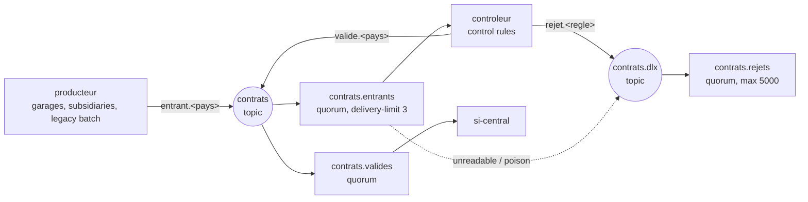

# Integration flow runbook: contracts over RabbitMQ

A small, production-shaped integration flow used to practise message-bus /
ESB patterns: decoupled applications, declarative topology, control rules,
dead-lettering, supervision and alerting.

## Architecture



| Component | Path | Role |
|---|---|---|
| RabbitMQ 4.2 | `kubernetes/apps/integration/rabbitmq/` | Broker, management UI, Prometheus endpoint |
| contrats-flow | `kubernetes/apps/integration/contrats-flow/` | 3 workers (`producteur`, `controleur`, `si-central`) running `resources/flow.py` |

Design choices:

- **Quorum queues** (replicated, Raft-based) instead of classic queues.
- **Publisher confirms + `mandatory`**: a message is acknowledged upstream only
  once the broker has accepted the downstream publish, so nothing is lost silently.
- **Business rejects vs technical rejects**: rule failures are routed explicitly
  to `contrats.dlx` with an `x-regle` header; unreadable messages are dead-lettered
  natively by the broker (`x-delivery-limit` stops poison messages from looping).
- **Data quality per source**: the producer simulates three source systems with
  different error rates, so the dashboard shows where rejects come from.
- **Zero-trust networking**: AMQP is only reachable from the flow workers,
  the management UI only through `envoy-internal`.

## Prerequisites

1Password item `rabbitmq` with the fields `RABBITMQ_USER` and `RABBITMQ_PASSWORD`
(read by the `rabbitmq` ExternalSecret, which also renders `rabbitmq.conf`).

## Verify

```sh
flux get ks -n integration
kubectl -n integration get pods
kubectl -n integration logs deploy/contrats-flow-controleur --tail=20
kubectl -n integration exec deploy/rabbitmq -- rabbitmqctl list_queues name type messages consumers
```

- Management UI: `https://rabbitmq.<domain>` (internal gateway).
- Grafana: dashboards **Flux contrats** and **RabbitMQ-Overview**.

## Demo scenarios

| Scenario | How | Expected |
|---|---|---|
| Data quality incident | set `PRODUCER_ERROR_RATIO` to `0.3` on `producteur` | reject rate > 15 %, `ContratsTauxDeRejetEleve` fires, the dashboard shows the rule and source at fault |
| Consumer outage | `kubectl -n integration scale deploy/contrats-flow-si-central --replicas=0` | `contrats.valides` grows, `ContratsFileSansConsommateur` then `ContratsFluxInterrompu` fire; scale back to 1 and the backlog drains with no loss |
| Poison messages | set `PRODUCER_POISON_RATIO` to `0.05` | messages land in `contrats.rejets` with routing key `rejet.illisible`, `ContratsMessagesIllisibles` fires |
| Broker restart | `kubectl -n integration rollout restart deploy/rabbitmq` | workers reconnect automatically, persistent messages survive |

Changes go through Git like everything else: edit the HelmRelease, open a PR,
let flux-local post the diff, merge, Flux applies it.

## Troubleshooting

- **Workers stuck in `Init`**: the `deps` init container installs `pika` and
  `prometheus-client` from PyPI; check egress to the internet.
- **`ACCESS_REFUSED` in worker logs**: the ExternalSecret has not synced yet,
  or the 1Password fields are missing.
- **Inspect a rejected contract**: in the management UI, open `contrats.rejets`,
  *Get messages* with *Ack mode: Nack message requeue true*; the headers carry
  `x-regle`, `x-source` and `x-pays`.
